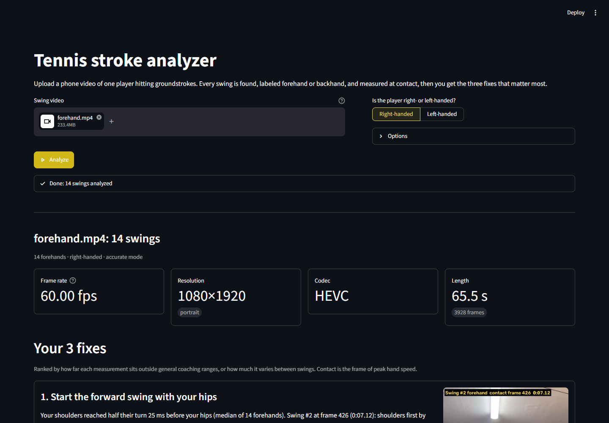

# Tennis Stroke Analyzer

**Upload a phone video of your groundstrokes. Get every swing measured at contact and the three fixes that matter most, each backed by a number and a frame you can check.**



<sub>[Full results page](docs/screenshots/03_results_full.png): fixes, a side-by-side against your best swing, the annotated video, and a table of every swing.</sub>

## What it does

- **Finds every swing** in a clip of one player hitting forehands and backhands. So far it has been built and tested on shadow swings (no ball).
- **Labels each swing** as a forehand or backhand, and one-handed or two-handed.
- **Measures each swing at contact:**
  - elbow angle
  - knee bend
  - shoulder and hip rotation
  - how far in front of the body the hand is
  - whether the hips or the shoulders start the forward swing
- **Gives exactly three fixes per session.** Each one cites the measured value, the swing number, and the frame and timestamp it came from. Nothing is a canned tip.
- **Shows a side-by-side** of one of your swings next to a reference swing, synced so both hit contact at the same moment. The reference is your own best swing, or a coach or pro clip you upload.
- **Draws the skeleton** on the whole video, with a frame counter so you can check every cited frame.
- **Reads phone video as it is:**
  - iPhone HEVC and portrait clips
  - frame rates tested at 30, 60 and 120 fps; higher rates also work, and timing always comes from each frame's real timestamp
  - every video shown in the app is H.264, so it plays in any browser

## How it works

1. **Read the video.** PyAV decodes the clip, including iPhone HEVC, and turns portrait videos upright. Each frame's real timestamp is kept, so phones with uneven frame timing still give correct speeds.
2. **Track the body.** MediaPipe Pose finds 33 body points on every frame. Points the model isn't confident about are thrown away, never guessed. That matters on a busy court or in a cluttered garage.
3. **Find the swings.** The fastest moments of the hitting hand are the swings. The frame of peak hand speed is treated as contact, since shadow swings have no ball.
4. **Measure precisely around contact.**
   - A fast, light model scans the whole clip.
   - A slower, more accurate model then re-tracks about one second around each contact.
   - Angles come from MediaPipe's 3D estimate of the body, so they don't depend much on where the camera stood.
5. **Coach.** Each measurement is compared with general coaching ranges, which you can edit in [`tennis_analyzer/targets.py`](tennis_analyzer/targets.py). The analyzer also checks how much each one varies from swing to swing. The three biggest, distinct problems become the fixes.
6. **Say what it couldn't measure.** If a joint was hidden or the tracking glitched, that measurement reads "not measured", with the reason. The analyzer never shows a made-up number.

## Run it

You need Python 3.11 (the version pinned and tested here) and an internet connection the first time, to download the pose models (about 36 MB, plus 9 MB more if you use fast mode). It's tested on Windows 11. macOS on Apple Silicon and Linux should work with the same steps; MediaPipe has no wheel for Intel Macs.

**Windows (PowerShell)**

```powershell
git clone <this-repo-url> tennis-analyzer
cd tennis-analyzer
py -3.11 -m venv .venv
.venv\Scripts\python -m pip install -r requirements.txt
.venv\Scripts\python -m streamlit run app.py
```

**macOS / Linux** (untested)

```bash
python3.11 -m venv .venv
.venv/bin/python -m pip install -r requirements.txt
.venv/bin/python -m streamlit run app.py
```

Then open http://localhost:8501. Upload a clip, choose right- or left-handed, and press **Analyze**. A one-minute 60 fps clip takes about three minutes on a laptop CPU the first time. The pose results are cached, so later runs on the same clip are much faster.

**Command line.** The app is a thin layer over the CLI, which does the same analysis:

```powershell
.venv\Scripts\python analyze.py path\to\clip.mov --hand right
.venv\Scripts\python analyze.py path\to\folder --hand left --no-video   # every clip in a folder, numbers only
.venv\Scripts\python analyze.py clip.mov --hand right --reference pro.mp4 --reference-hand right
```

Results go to `out/<clip>/`:
- `report.json`
- `annotated.mp4`
- `contacts/swing_NN.jpg`
- the side-by-side video

**Tests:**

```powershell
.venv\Scripts\python -m pip install -r requirements-dev.txt
.venv\Scripts\python -m pytest -q
```

### Filming tips

- Film from the side, at about hip height, with the whole body in frame.
- Shoot at 60 fps or higher.
- Keep the phone still: use a tripod, or lean it against the fence.
- Keep one player in the shot.

## Known limitations

- **False swings from walking, camera movement or fidgeting.**
  - Swing detection uses hand speed in the picture, so the player walking around or the camera panning can count as a swing.
  - A clip that starts with the player getting into position may show a few extra "swings". They are often labeled with the wrong stroke, and they can skew the fixes.
  - Workaround: trim the clip to the hitting, and keep the camera still.
- **Face-on clips can lose rotation.**
  - When the player turns their back to the camera, the pose model sometimes swaps the body's left and right sides.
  - The analyzer detects this and marks shoulder/hip rotation "not measured" rather than reporting an impossible number. A face-on session may therefore get fewer than three fixes.
  - Filming from the side avoids it.
- **Contact is estimated.** It's the frame of peak hand speed, which in a real stroke comes slightly before ball impact.
  - "Contact in front" is sensitive to that exact frame. At 5 m/s, one frame is about 8 cm at 60 fps and about 16 cm at 30 fps, so prefer 60 fps or higher.
- **Single-swing values are noisy.** Rotation and timing come from a single camera's 3D estimate, so one swing's number can shift by a few degrees or tens of milliseconds. The session medians the fixes are built on are much steadier.
- **Coaching ranges are generic.** They're broad groundstroke guidelines, not tuned to a player's level or style.
- **Slow-motion exports** that are stored at a lower playback rate than they were filmed at aren't time-corrected yet.

## What's next

- **Fix the false swings:** measure hand speed relative to the hips, so walking and camera pans cancel out.
- **Handle slow-motion exports:** use the phone's capture-frame-rate tag to correct their timing.
- **Track the ball:** find the real contact frame when a ball is present, instead of using peak hand speed.
- **Bundle reference swings:** ship a small library of coach-approved forehands and backhands to compare against.
- **Track progress:** compare sessions over time and show whether a fix is sticking.

## Project layout

```
app.py                     Streamlit UI (only calls the package)
analyze.py                 Command-line interface
tennis_analyzer/
  video_io.py              Decoding, rotation, timestamps, H.264 writing (PyAV)
  pose.py                  MediaPipe Tasks PoseLandmarker, model download, cache
  kinematics.py            Confidence masking, glitch removal, smoothing, angles
  swings.py                Swing detection, forehand/backhand, grip, facing direction
  metrics.py               Contact measurements
  coaching.py, targets.py  Reference choice, the 3 fixes, guideline ranges
  outputs.py, render.py    Annotated video, contact stills, side-by-side
scripts/screenshot_ui.py   Playwright: upload a clip, screenshot, check videos play
tests/                     Unit tests
```

Built with [MediaPipe](https://ai.google.dev/edge/mediapipe), [PyAV](https://pyav.basswood-io.com/), [OpenCV](https://opencv.org/) and [Streamlit](https://streamlit.io/). The PyAV wheels bundle FFmpeg with libx264, which is GPL-licensed.
